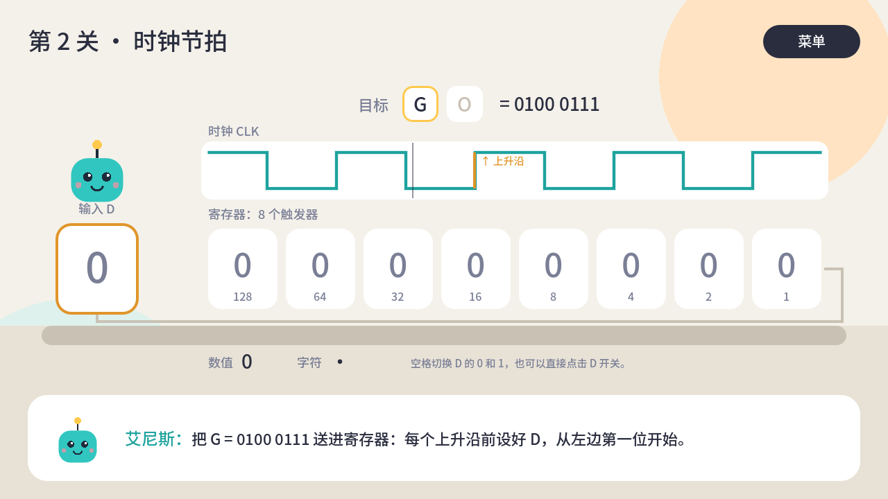
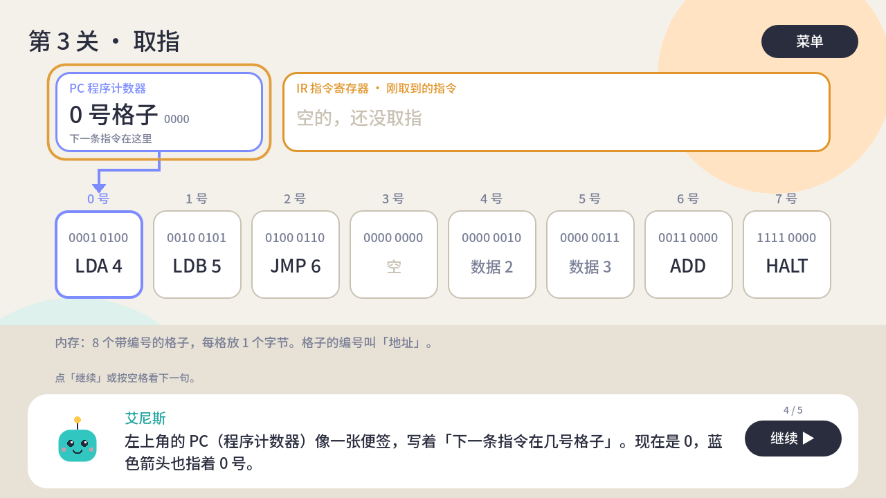

# ANX：计算机里的世界 / ANX: Inside the Computer

一款全平台的计算机科普游戏。玩家化身比特「艾尼斯」（ANX），从一个比特出发，走遍 CPU、操作系统和互联网，最后在 DLC 里指挥成千上万个 GPU 线程跑起大模型。

A cross-platform game about how computers really work. You play ANX, a newborn bit, and travel through the CPU, the operating system and the internet. A paid DLC covers GPUs, CUDA and LLMs.


## 当前进度 / Status

第 1 关「比特诞生」可玩原型：翻转 8 个开关组成一个字节，依次拼出 A、N、X 的 ASCII 码，通关后解锁知识卡。

- 操作：← → 移动，空格翻转，Tab 打开 ASCII 表；鼠标或触屏直接点击开关
- ASCII 表：右上角按钮随时打开，列出 A–Z 的十进制和二进制编码，标出目标字母和当前拼出的字母
- 主菜单选择中文或 English，选择会保存下来；关卡右上角「菜单」返回，Esc 也可以
- 全部画面用代码绘制（扁平矢量风格），暂无美术素材

第 2 关「时钟节拍」：时钟驱动一个 8 位移位寄存器，玩家设置输入 D，每个上升沿寄存器左移一位并记住 D。依次送入 G、O（第二轮时钟更快），通关后解锁「时钟与触发器」知识卡。第 1 关通关后点「下一关」进入。



第 3 关「取指」：先由艾尼斯一句一句讲清楚什么是内存、地址、PC 和 IR（讲到哪里就高亮哪里），再让玩家动手：顺着蓝色箭头去 PC 指的格子取指，指令进入 IR 并显示白话意思，PC 加 1；遇到 JMP 时 PC 被直接改写，数据格子被跳过。一直取到 HALT，解锁「程序计数器与取指」知识卡。



### 开发者命令台 / Developer console

任何界面按 <code>`</code> 打开（触屏：5 秒内连点左上角 5 次）。命令：

| 命令 | 作用 |
| --- | --- |
| `test` | 选关 |
| `menu` | 回主菜单 |
| `lang zh` / `lang en` | 切换语言 |
| `help` | 显示命令 |

新关卡只要加进 `scripts/levels.gd` 就会出现在选关列表里。

## 运行 / Run

需要 [Godot 4.3+](https://godotengine.org/download)（标准版，GDScript）。

```sh
godot --path .                       # 运行游戏 / play
godot --headless --path . -s tests/test_bit_logic.gd   # 单元测试 / unit tests
godot --headless --path . -s tests/test_level_02.gd    # 第 2 关自动通关测试
godot --headless --path . -s tests/test_level_03.gd    # 第 3 关自动通关测试
godot --path . res://scenes/level_01.tscn -- --demo=complete   # 直接显示通关画面，方便截图
godot --path . res://scenes/level_01.tscn -- --demo=table      # 直接显示 ASCII 表
```

也可以用 Godot 编辑器打开 `project.godot`，按 F5 运行。

### AI 自动试玩 / AI playtest

```sh
tools/playtest.sh           # 无头快速跑（约 10 秒），CI 也跑这个
tools/playtest.sh --shots   # 在 xvfb 下真实渲染，每句对白截一张图
```

一个机器人从主菜单开始，只用按键和点击，中文、英文各把所有关卡通关一遍；再对每关随机乱点乱按 300 次，然后确认还能通关（不崩、没有死局）。同时检查：文字超出屏幕或按钮、缺翻译、对白太长、卡住超时、脚本报错。报告写在 `build/playtest/report.md`（另有 `report.json` 和截图），CI 上显示在运行的 Summary 页，并保存为 `playtest-report` 附件。

每关的玩法写在 `tests/playtest/brains/<关卡场景名>.gd`。改关卡后「跑测试 → 看报告和截图 → 按初学者视角自查 → 修改」的自迭代流程见 [CLAUDE.md](CLAUDE.md)。

## 目录 / Layout

| 路径 | 内容 |
| --- | --- |
| `scenes/main_menu.tscn` | 主菜单：选择语言、开始游戏 |
| `scenes/level_01.tscn` | 第 1 关场景 |
| `scripts/flat_canvas.gd` | 所有画面共用的绘制基类：字体、背景、按钮、艾尼斯 |
| `scripts/level_01.gd` | 第 1 关玩法与绘制 |
| `scenes/level_02.tscn`、`scripts/level_02.gd` | 第 2 关：时钟与移位寄存器 |
| `scenes/level_03.tscn`、`scripts/level_03.gd`、`scripts/cpu_logic.gd` | 第 3 关：程序计数器与取指 |
| `scripts/bit_logic.gd`、`scripts/clock_logic.gd` | 比特、时钟、移位寄存器的纯逻辑（有单元测试） |
| `scripts/levels.gd` | 关卡列表，主菜单、关卡和命令台共用 |
| `scripts/dev_console.gd` | 开发者命令台（autoload `DevConsole`） |
| `scripts/palette.gd` | 扁平矢量配色 |
| `scripts/loc.gd` | 语言选择与保存（autoload `Loc`），首次启动按系统语言 |
| `data/strings.gd` | 全部中英文文本，每个 key 必须同时有 `zh` 和 `en` |
| `tests/` | 无头运行的测试脚本 |
| `tests/playtest/` | AI 自动试玩：`playtest.gd` 驱动，`brains/` 里每关一个玩法脚本 |
| `tools/playtest.sh` | 运行 AI 试玩并检查日志 |
| `CLAUDE.md` | 开发须知与自迭代流程 |
| `tools/subset_font.py` | 生成内置中文字体子集 |
| `export_presets.cfg` | Web 导出配置 |

## Web 版与 CI / Web build and CI

`.github/workflows/web.yml` 在每次推送到 `main` 时自动运行测试、导出 Web 版并发布到 GitHub Pages；PR 上只测试和导出，不发布。

- 测试（`test`）、AI 试玩（`playtest`）和 Web 导出（`export-web`）在三个 runner 上并行跑，发布（`deploy`）等三者都通过
- `.github/actions/setup-godot` 缓存 Godot 本体、只含 Web 的导出模板和 `.godot/` 导入缓存，命中缓存时不用再下载 1 GB 的模板包或容器镜像

首次使用需要在仓库 Settings → Pages → Source 选择 **GitHub Actions**。发布地址：https://kalijerry.github.io/game_anx/

Web 导出关闭了多线程，所以 GitHub Pages 不需要额外的 COOP/COEP 响应头。

## 字体 / Font

游戏内置 `assets/fonts/anx_ui.ttf`，是 Noto Sans SC（SIL OFL 1.1，见 `assets/fonts/OFL.txt`）的子集，只含游戏用到的字。新增文本后重新生成：

```sh
pip install fonttools
python tools/subset_font.py path/to/NotoSansSC[wght].ttf
```

单元测试会检查所有文本都能被这个字体显示，漏了字会直接失败。

## 路线图 / Roadmap

1. 硬件篇 MVP：比特诞生 → 时钟节拍 → 取指 → 译码与执行 → 缓存未命中，外加 3 个搭建挑战关
2. 操作系统篇
3. 网络篇
4. DLC：GPU 与大模型

完整设计稿见项目里的 Claude 文档。
