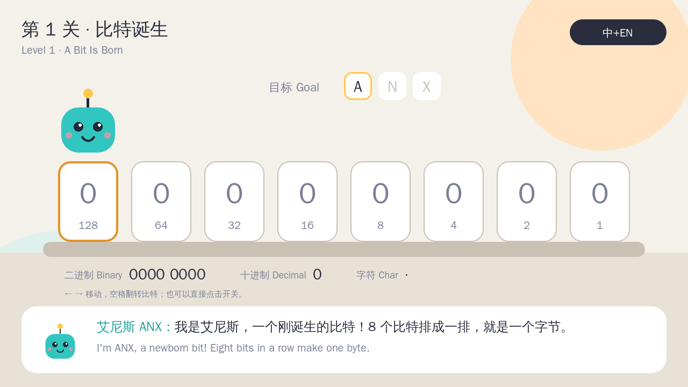

# ANX：计算机里的世界 / ANX: Inside the Computer

一款全平台的计算机科普游戏。玩家化身比特「艾尼斯」（ANX），从一个比特出发，走遍 CPU、操作系统和互联网，最后在 DLC 里指挥成千上万个 GPU 线程跑起大模型。

A cross-platform game about how computers really work. You play ANX, a newborn bit, and travel through the CPU, the operating system and the internet. A paid DLC covers GPUs, CUDA and LLMs.



## 当前进度 / Status

第 1 关「比特诞生」可玩原型：翻转 8 个开关组成一个字节，依次拼出 A、N、X 的 ASCII 码，通关后解锁知识卡。

- 操作：← → 移动，空格翻转；鼠标或触屏直接点击开关
- 右上角按钮切换显示：中+EN / 中文 / EN
- 全部画面用代码绘制（扁平矢量风格），暂无美术素材

## 运行 / Run

需要 [Godot 4.3+](https://godotengine.org/download)（标准版，GDScript）。

```sh
godot --path .                       # 运行游戏 / play
godot --headless --path . -s tests/test_bit_logic.gd   # 单元测试 / unit tests
godot --path . -- --demo=complete    # 直接显示通关画面，方便截图
```

也可以用 Godot 编辑器打开 `project.godot`，按 F5 运行。

## 目录 / Layout

| 路径 | 内容 |
| --- | --- |
| `scenes/level_01.tscn` | 第 1 关场景 |
| `scripts/level_01.gd` | 第 1 关玩法与绘制 |
| `scripts/bit_logic.gd` | 比特与字节的纯逻辑（有单元测试） |
| `scripts/palette.gd` | 扁平矢量配色 |
| `scripts/loc.gd` | 中英文切换（autoload `Loc`） |
| `data/strings.gd` | 全部中英文文本，每个 key 必须同时有 `zh` 和 `en` |
| `tests/` | 无头运行的测试脚本 |

## 已知事项 / Notes

- 字体目前用系统字体（苹方、微软雅黑、Noto Sans CJK 等）。导出 Web 和手机版之前，需要内置一个开源中文字体子集，例如 Noto Sans SC。
- 导出各平台需要先在编辑器里安装 Export Templates。

## 路线图 / Roadmap

1. 硬件篇 MVP：比特诞生 → 时钟节拍 → 取指 → 译码与执行 → 缓存未命中，外加 3 个搭建挑战关
2. 操作系统篇
3. 网络篇
4. DLC：GPU 与大模型

完整设计稿见项目里的 Claude 文档。
