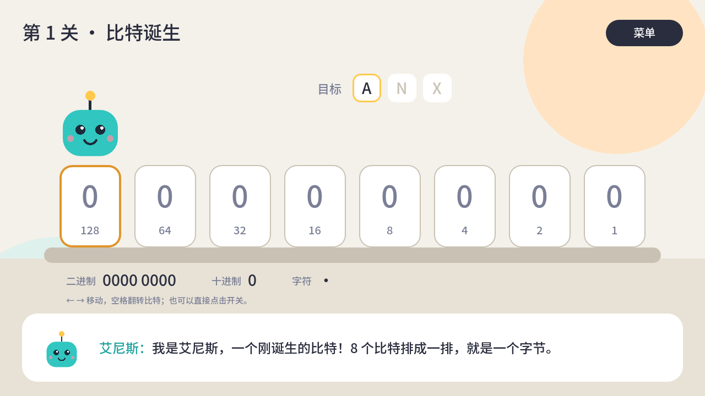

# ANX：计算机里的世界 / ANX: Inside the Computer

一款全平台的计算机科普游戏。玩家化身比特「艾尼斯」（ANX），从一个比特出发，走遍 CPU、操作系统和互联网，最后在 DLC 里指挥成千上万个 GPU 线程跑起大模型。

A cross-platform game about how computers really work. You play ANX, a newborn bit, and travel through the CPU, the operating system and the internet. A paid DLC covers GPUs, CUDA and LLMs.




## 当前进度 / Status

第 1 关「比特诞生」可玩原型：翻转 8 个开关组成一个字节，依次拼出 A、N、X 的 ASCII 码，通关后解锁知识卡。

- 操作：← → 移动，空格翻转；鼠标或触屏直接点击开关
- 主菜单选择中文或 English，选择会保存下来；关卡右上角「菜单」返回，Esc 也可以
- 全部画面用代码绘制（扁平矢量风格），暂无美术素材

## 运行 / Run

需要 [Godot 4.3+](https://godotengine.org/download)（标准版，GDScript）。

```sh
godot --path .                       # 运行游戏 / play
godot --headless --path . -s tests/test_bit_logic.gd   # 单元测试 / unit tests
godot --path . res://scenes/level_01.tscn -- --demo=complete   # 直接显示通关画面，方便截图
```

也可以用 Godot 编辑器打开 `project.godot`，按 F5 运行。

## 目录 / Layout

| 路径 | 内容 |
| --- | --- |
| `scenes/main_menu.tscn` | 主菜单：选择语言、开始游戏 |
| `scenes/level_01.tscn` | 第 1 关场景 |
| `scripts/flat_canvas.gd` | 所有画面共用的绘制基类：字体、背景、按钮、艾尼斯 |
| `scripts/level_01.gd` | 第 1 关玩法与绘制 |
| `scripts/bit_logic.gd` | 比特与字节的纯逻辑（有单元测试） |
| `scripts/palette.gd` | 扁平矢量配色 |
| `scripts/loc.gd` | 语言选择与保存（autoload `Loc`），首次启动按系统语言 |
| `data/strings.gd` | 全部中英文文本，每个 key 必须同时有 `zh` 和 `en` |
| `tests/` | 无头运行的测试脚本 |
| `tools/subset_font.py` | 生成内置中文字体子集 |
| `export_presets.cfg` | Web 导出配置 |

## Web 版与 CI / Web build and CI

`.github/workflows/web.yml` 在每次推送到 `main` 时自动运行测试、导出 Web 版并发布到 GitHub Pages；PR 上只测试和导出，不发布。

首次使用需要在仓库 Settings → Pages → Source 选择 **GitHub Actions**。发布地址：https://kalijerry.github.io/game_anx/

Web 导出关闭了多线程，所以 GitHub Pages 不需要额外的 COOP/COEP 响应头。

## 字体 / Font

游戏内置 `assets/fonts/anx_ui.ttf`，是 Noto Sans SC（SIL OFL 1.1，见 `assets/fonts/OFL.txt`）的子集，只含游戏用到的字。新增文本后重新生成：

```sh
pip install fonttools
python tools/subset_font.py path/to/NotoSansSC[wght].ttf
```

单元测试会检查所有文本都能被这个字体显示，漏了字会直接失败。

## 路线图 / Roadmap

1. 硬件篇 MVP：比特诞生 → 时钟节拍 → 取指 → 译码与执行 → 缓存未命中，外加 3 个搭建挑战关
2. 操作系统篇
3. 网络篇
4. DLC：GPU 与大模型

完整设计稿见项目里的 Claude 文档。
